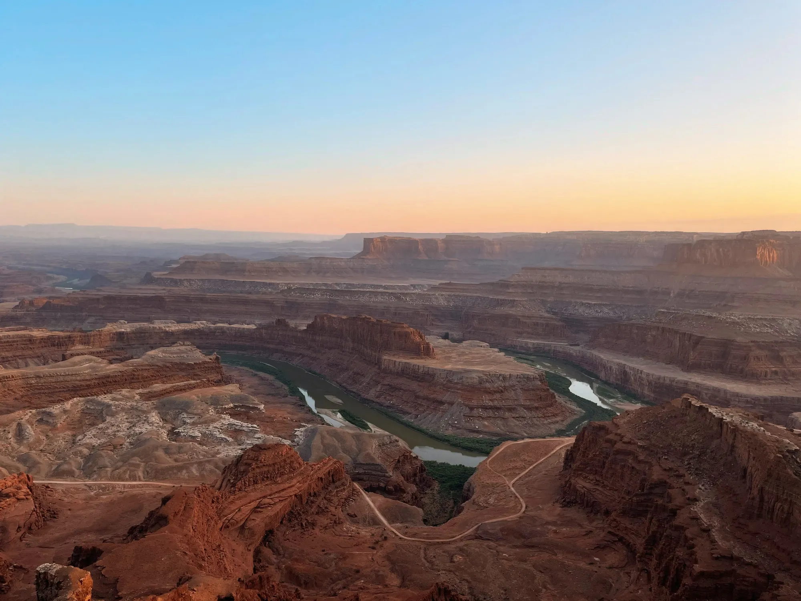
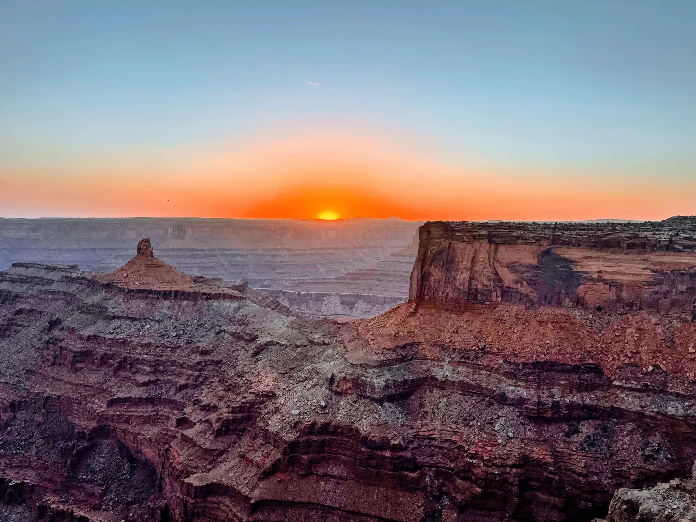
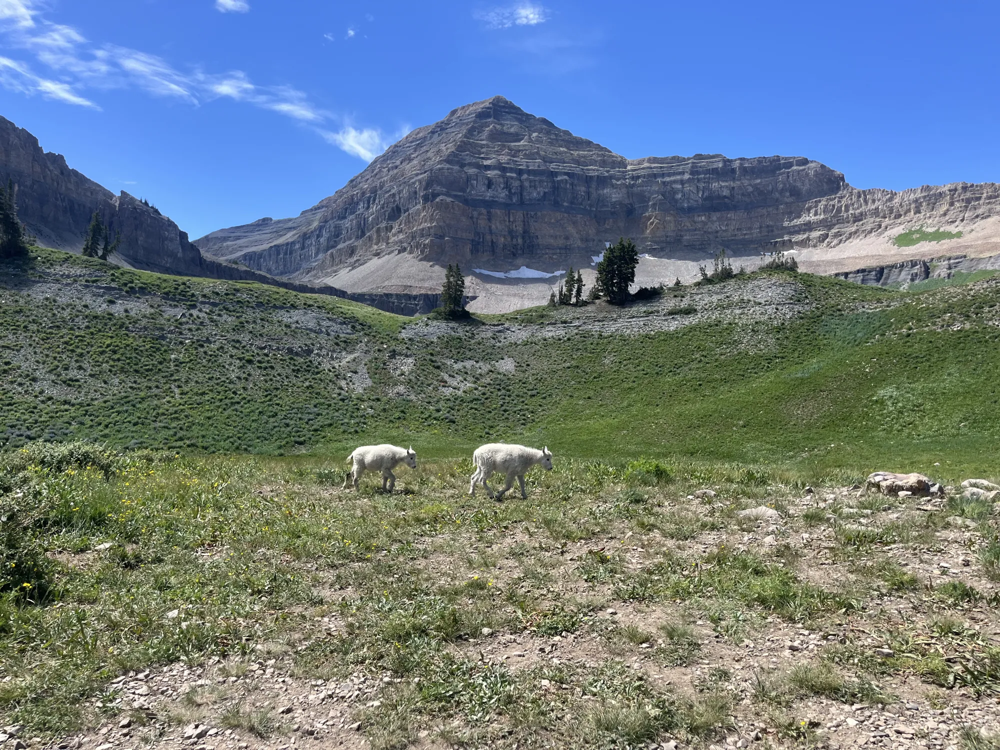
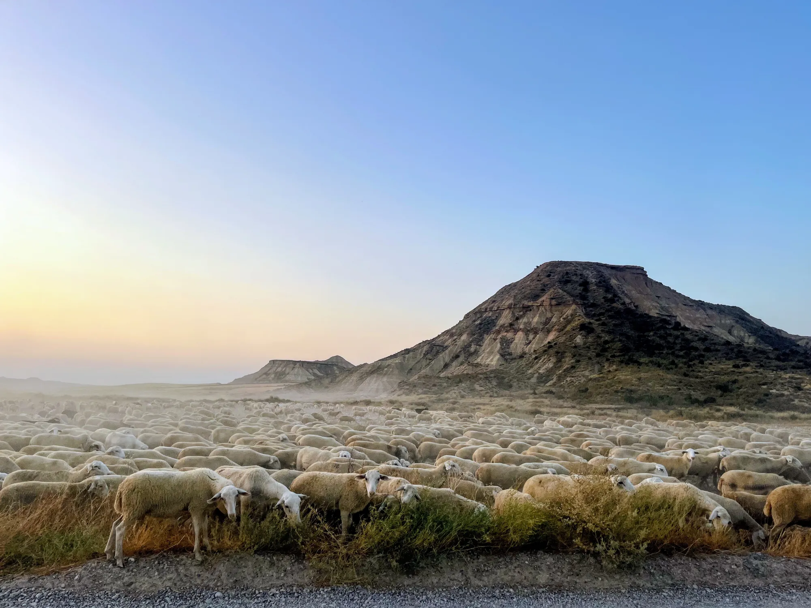
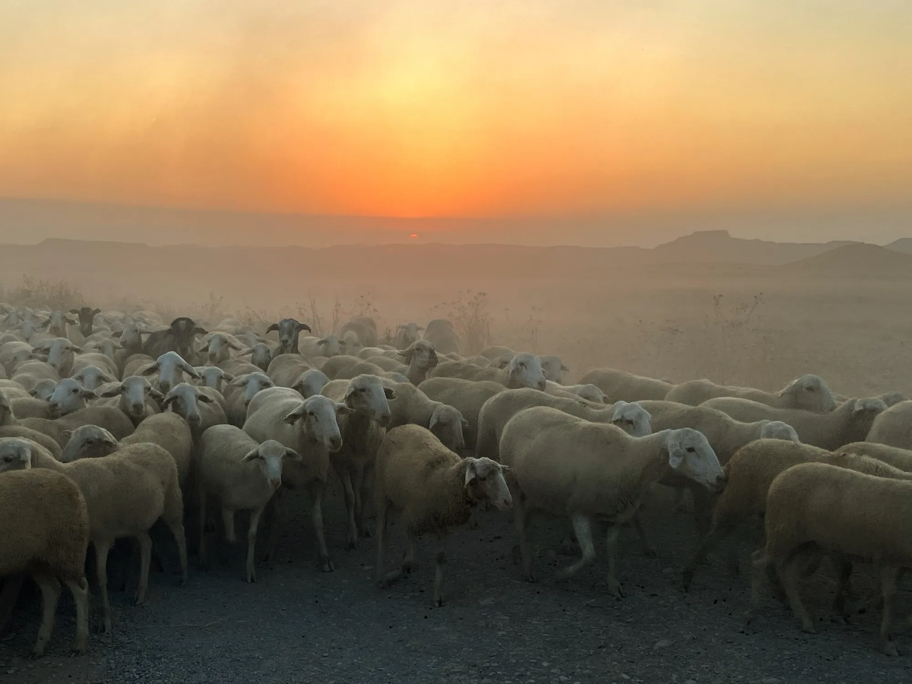

When I'm not modeling, I'm usually outside: climbing, hiking, or chasing the light in canyon country. Click a photo to see it full size.

::: mp-gallery

{group="photos" fig-alt="Sunrise over the Colorado River gooseneck seen from a canyon rim"}

{group="photos" fig-alt="The sun setting behind layered sandstone mesas"}

{group="photos" fig-alt="Switchback road descending a red sandstone canyon wall"}

{group="photos" fig-alt="Two mountain goats grazing below a rocky peak"}

{group="photos" fig-alt="A flock of sheep crossing grassland below a flat-topped butte"}

{group="photos" fig-alt="A flock of sheep moving through dust at sunset"}

{group="photos" fig-alt="Eroded badlands under a clear sky"}

:::
