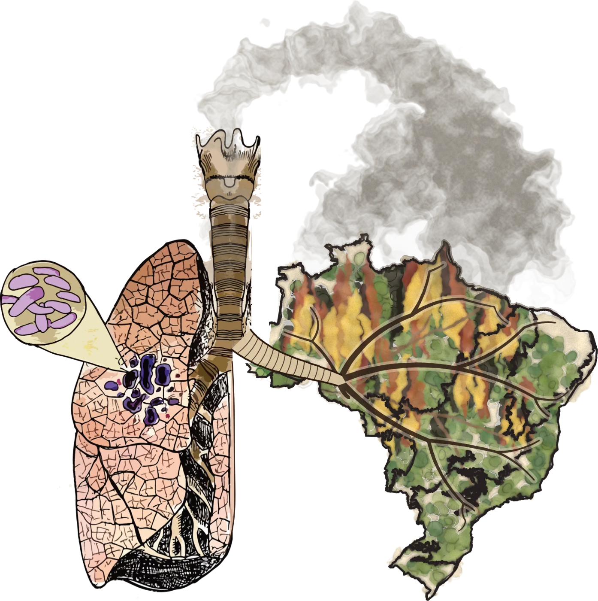

My research sits at the intersection of infectious disease epidemiology, quantitative modeling, and genomics. I develop statistical and mechanistic models to understand how infections spread and how interventions can be designed to stop them, drawing on large-scale clinical, genomic, and environmental datasets.

<a class="mp-button mp-button--ghost" href="publications.qmd">All publications</a>

::::: mp-theme
<figure class="mp-theme__fig mp-theme__fig--photo"></figure>

::: mp-theme__text
### Antibiotic use and resistance

antimicrobial resistancestewardshiphealth-system data

Understanding how antibiotic use drives resistance is essential for designing effective stewardship. Using clinical and genomic data from the US Veterans Affairs Healthcare System (about 1 million patients across 138 medical centers) and the Calgary Health Region (about 25,000 isolates), I have characterized nationwide trends in infection incidence and antimicrobial resistance, and developed statistical models of how prescribing selects for resistance in major bacterial pathogens.

**Selected work**

- **Pham TM** et al. (2026). Antimicrobial selection and multidrug resistance in four major pathogens in the US Veterans Affairs health-care system. *The Lancet Microbe*. [doi:10.1016/j.lanmic.2026.101445](https://doi.org/10.1016/j.lanmic.2026.101445)
- **Pham TM** et al. (2024). Trends in infection incidence and antimicrobial resistance in the US Veterans Affairs Healthcare System (2007–22). *The Lancet Infectious Diseases*. [doi:10.1016/S1473-3099(24)00416-X](https://doi.org/10.1016/S1473-3099(24)00416-X)
- **Pham TM** et al. (2026). Trends in incidence and resistance for five major causes of bacteremia in a Canadian metropolitan area, 2006–22. *medRxiv*, under review. [doi:10.64898/2026.08.27.26361471](https://doi.org/10.64898/2026.08.27.26361471)
:::
:::::

::::: {.mp-theme .mp-theme--flip}
<figure class="mp-theme__fig"><figcaption>Illustration based on work by Chenyu Zhang, adapted with Claude.</figcaption></figure>

::: mp-theme__text
### Environmental exposures and tuberculosis

air pollutionpanel regressiontuberculosis

At the University of Utah, I study how environmental factors shape infectious disease dynamics. Using Brazil's national TB surveillance data (more than 1.7 million cases, 2003–2023), I develop panel regression models that quantify how ambient and wildfire-related air pollution affects tuberculosis notifications, and models of the seasonality of TB. This work integrates meteorological, air quality, and epidemiological data across a country with enormous geographic and socioeconomic diversity.

**Selected work**

- **Pham TM** et al. (2026). Impact of wildfire-related fine particulate matter on tuberculosis notifications in Brazil: a nationwide panel study, 2003–2023. *medRxiv*, under review. [doi:10.64898/2026.07.01.26356762](https://doi.org/10.64898/2026.07.01.26356762)
:::
:::::

::::: mp-theme
<figure class="mp-theme__fig mp-theme__fig--photo"><figcaption>A phylogeny drawn over the ridges of eroded badlands.</figcaption></figure>

::: mp-theme__text
### Transmission dynamics and genomic epidemiology

mechanistic modelsBayesian inferencepathogen genomics

A central thread across my work is using mathematical and statistical models to inform infection prevention and control. During the COVID-19 pandemic, I developed agent-based and compartmental models that directly informed policy: an agent-based model of SARS-CoV-2 transmission in Dutch secondary schools supported re-opening strategies for the Netherlands Ministry of Education, and statistical models of hospital-acquired COVID-19 contributed to the UK's Scientific Advisory Group for Emergencies (SAGE).

My PhD focused on nosocomial transmission of *Pseudomonas aeruginosa* in intensive care units, combining surveillance data with transmission models to quantify routes of spread, including environmental contamination after discharge. More recently, I have used genomic epidemiology to distinguish local transmission from importation of SARS-CoV-2 in the National Basketball Association, and I am developing models to estimate the size of *M. tuberculosis* transmission bottlenecks.

**Selected work**

- Cooper BS, Evans S, Jafari Y, **Pham TM** et al. (2023). The burden and dynamics of hospital-acquired SARS-CoV-2 in England. *Nature*. [doi:10.1038/s41586-023-06634-z](https://doi.org/10.1038/s41586-023-06634-z)
- **Pham TM** et al. (2021). Interventions to control nosocomial transmission of SARS-CoV-2: a modelling study. *BMC Medicine*. [doi:10.1186/s12916-021-02060-y](https://doi.org/10.1186/s12916-021-02060-y)
- Teslya A\*, **Pham TM**\* et al. (2020). Impact of self-imposed prevention measures and short-term government-imposed social distancing on mitigating and delaying a COVID-19 epidemic. *PLOS Medicine*. [doi:10.1371/journal.pmed.1003166](https://doi.org/10.1371/journal.pmed.1003166)
- **Pham TM** et al. (2022). Routes of transmission of VIM-positive *Pseudomonas aeruginosa* in the adult intensive care unit. *Antimicrobial Resistance & Infection Control*. [doi:10.1186/s13756-022-01095-x](https://doi.org/10.1186/s13756-022-01095-x)
:::
:::::
